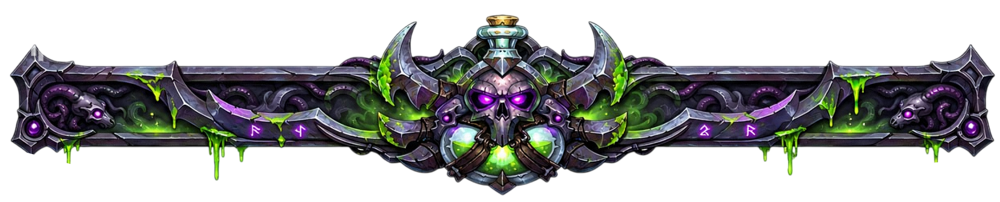

 

 

*“Some souls are never meant to walk in the light.”*

 

☾　✦　☽

 

**ROGUE AT HEART**

CHILD OF THE FORSAKEN · WALKER OF THE SHADOWS

  

A quiet presence in a noisy world.

 

Drawn to forgotten places, ancient stories, and the beauty of things left in the dark.

  

  

 

*“The shadows are not empty. They remember.”*

 

*“Not every light offers salvation.”*

  

WANDER QUIETLY · LEAVE SOMETHING BEHIND

  

