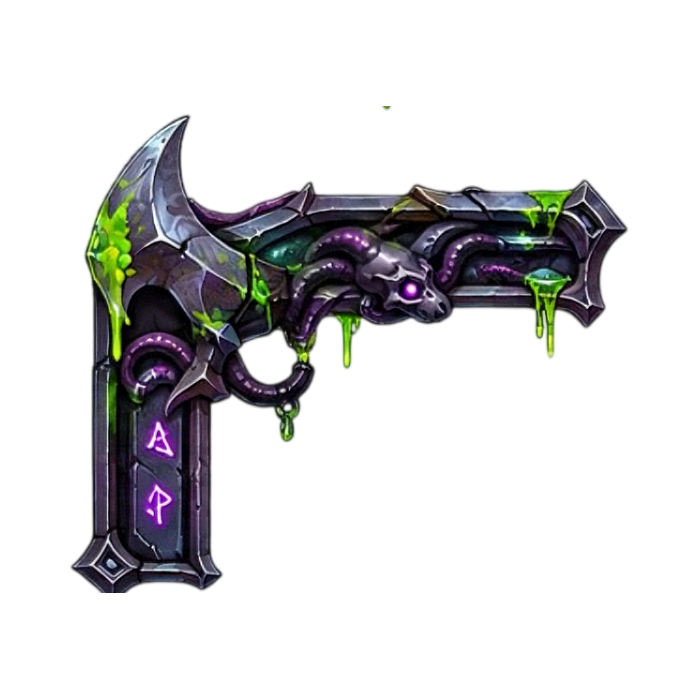
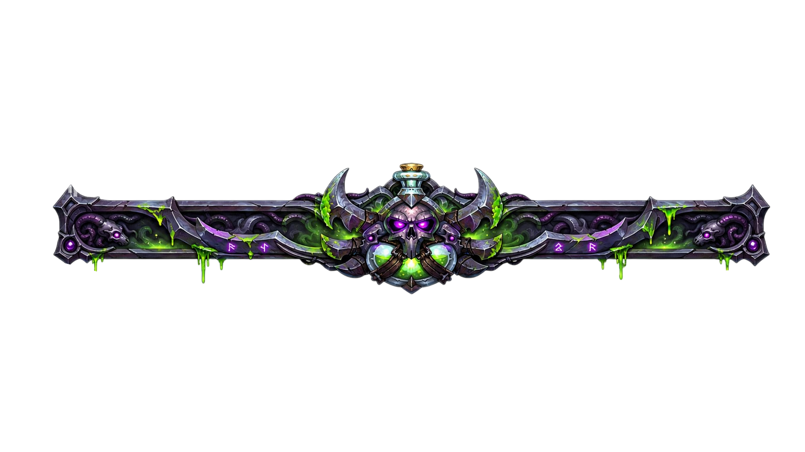
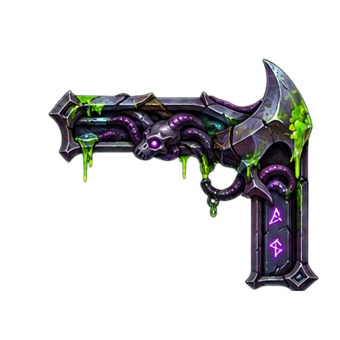
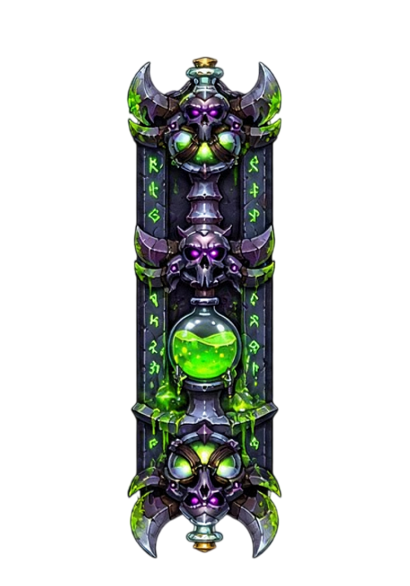
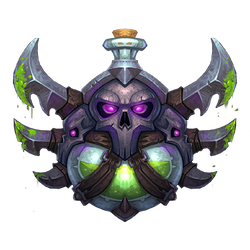
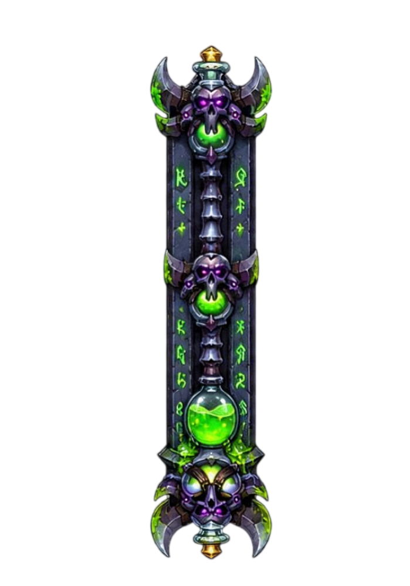
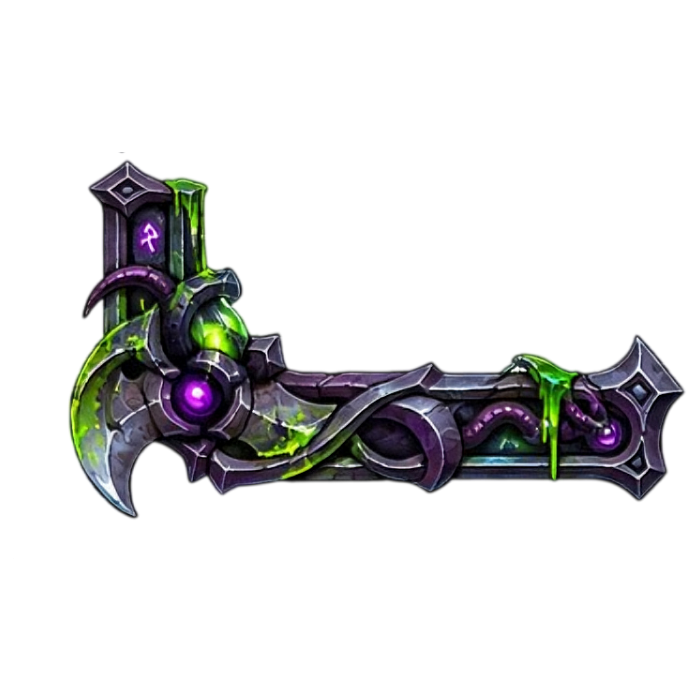
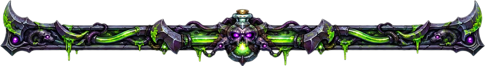
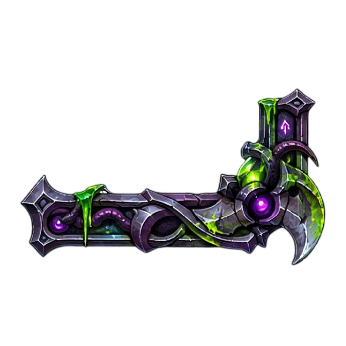

<table width="100%" cellspacing="0" cellpadding="0">
<tr>
<td width="15%" align="right" valign="bottom"></td>
<td width="76%" align="center" valign="bottom"></td>
<td width="15%" align="left" valign="bottom"></td>
</tr>
<tr>
<td width="12%" align="right" valign="top"></td>
<td width="76%" align="center" valign="top">

<!-- CONTEÚDO CENTRAL -->

  

  

*“Some souls are never meant to walk in the light.”*

  

☾　✦　☽

  

**ROGUE AT HEART**

 

CHILD OF THE FORSAKEN · WALKER OF THE SHADOWS

  

A quiet presence in a noisy world.

 

Drawn to forgotten places, ancient stories, and the beauty of things left in the dark.

  

  

<h2>☽ BEYOND THE VEIL ☾</h2>

 

*Not every shadow hides a monster.*

 

*Not every light offers salvation.*

  

Somewhere between the forgotten kingdoms of Azeroth and the silence of the void, there is a place for those who never quite belonged.

  

I have always found something fascinating in the mysterious, the unconventional, and the stories that linger long after the world has moved on.

  

✧　**Not all who wander seek the light.**　✧

  

<h2>✦ THE VOID WITHIN ✦</h2>

 

☾ MYSTERY
 
Drawn to the unknown.
  
✦ SHADOW
 
Quiet, observant, relentless.
  
☽ FREEDOM
 
Walking my own path.

  

 

*“The shadows are not empty. They remember.”*

  

UMBRA CORE X

 

WANDER QUIETLY · LEAVE SOMETHING BEHIND

  

<!-- FIM DO CONTEÚDO CENTRAL -->

</td>
<td width="12%" align="left" valign="top"></td>
</tr>
<tr>
<td width="15%" align="right" valign="top"></td>
<td width="76%" align="center" valign="top"></td>
<td width="15%" align="left" valign="top"></td>
</tr>
</table>

